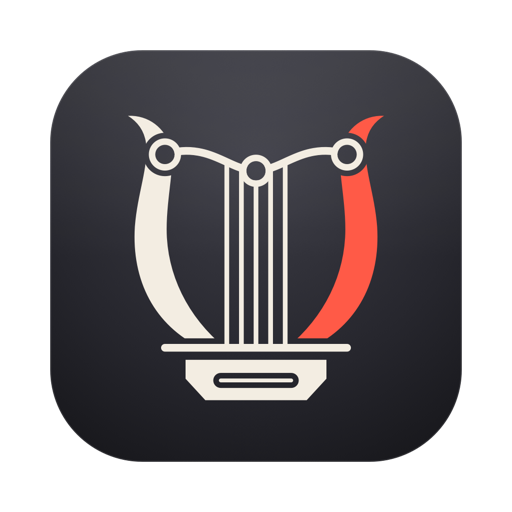

<p align="center">
  
</p>

<h1 align="center">Melicum</h1>

<p align="center"><b>HDMI and DisplayPort volume control for macOS.</b><br><a href="https://debba.github.io/melicum/">Website</a> · <a href="https://github.com/debba/melicum/releases">Download</a></p>

A native macOS audio app focused on HDMI and DisplayPort volume control. Software gain works even when a digital output has no hardware volume control. The optional system volume component also enables the macOS volume slider and native volume keys.

Melicum uses an independent SwiftUI interface, Core Audio routing, and C DSP. It requires macOS 14.2 or later. Building from source additionally requires Xcode and Swift. English is the default language; Italian, French, German, and Spanish are available under **Presets → Language**.

## Screenshots

| Main window | Spatial audio | Presets |
| :---: | :---: | :---: |
|  |  |  |
| Output, volume, spectrum and EQ | Room presets, reverb and stereo width | Super presets, AutoEQ import and language |

## Getting started

1. Download the latest `.dmg` from [Releases](https://github.com/debba/melicum/releases), drag **Melicum** to **Applications**, and open it. Release builds are signed with a Developer ID and notarized by Apple.
2. Choose a monitor or audio device under **Audio output**. Devices with identical names are numbered separately.
3. Click **Enable audio** and approve system audio recording in the macOS permission dialog. Melicum processes audio locally without saving recordings or sending audio over the network.
4. Adjust **Volume**, **Mute**, balance, and boost. The menu bar panel provides quick access to these controls.
5. To use native macOS volume controls, click **Enable system volume…** and complete the installer using an administrator account. It installs `MelicumSystemVolume.driver` in `/Library/Audio/Plug-Ins/HAL` and restarts the audio service. Enable audio again after installation. The virtual output appears as **Melicum**, while playback continues on the physical output selected in the app. Volume and mute stay synchronized between Melicum and macOS. Accessibility permission is unnecessary in this mode.
6. Without the optional component, **Volume keys** offers a keyboard shortcut fallback. Enable Melicum under **System Settings → Privacy & Security → Accessibility**, then click the button again. This fallback controls keyboard volume keys while audio processing runs; the native HDMI volume slider remains unavailable.

Settings are stored in `~/Library/Application Support/Melicum/settings.json`. Melicum starts with audio processing disabled. **Launch at login** opens the app without automatically capturing audio.

**Disable** and **Quit** close the taps and aggregate devices, restoring the previous output when available. Processing stops if the physical device disconnects, its sample rate changes, or macOS selects another output. Choose the desired output and enable audio again.

## Features

| Feature | Implementation |
| --- | --- |
| HDMI / DisplayPort volume | Software volume, mute, 0–12 dB boost, L/R balance, menu bar controls |
| Native system volume | Optional virtual output with bidirectional volume/mute synchronization and native volume keys |
| Basic EQ | Bass, mid, and treble |
| Advanced EQ | 10 fixed bands |
| Expert EQ | Up to 64 filters with independent frequency, gain, Q, and bypass; bell, low/high shelf, low/high pass, notch, and band pass |
| Spectrum | 2,048-sample FFT of processed audio, displayed in 64 logarithmic bins |
| Peak protection | Clamps output samples to ±0.98; this is not a true-peak limiter |
| App mixer | Separate taps for applications with custom volume, grouped by bundle identifier |
| Spatial audio | Original stereo reverb with five room sizes and mid/side width adjustment |
| Audio Units | Chain of up to 12 installed effects compatible with stereo float PCM; generic parameter editor |
| AutoEQ import | Local ParametricEQ `.txt` files in Equalizer APO / REW format |
| Super presets | Complete settings snapshots, JSON import/export, output associations, and app-triggered recall |
| Interface | Fixed graphite, cream and red palette from the logo, menu bar panel, launch at login, five languages |

This version supports **mono/stereo PCM**. Configure multichannel HDMI devices for two channels in **Audio MIDI Setup**. Dolby/DTS passthrough and protected streams unavailable to macOS process taps are unsupported. The online AutoEQ database and proprietary plugin interfaces are not included. Incompatible Audio Units cancel startup with an error; effects that fail during rendering are bypassed. Peak protection operates per stream, so the sum of multiple mixer streams can still exceed full scale.

Output presets are recalled when selecting an output in Melicum. App presets are recalled when the active playback application changes, preferring the foreground application and otherwise the first active application alphabetically. Changing the mixer or Audio Unit chain rebuilds the audio path and may briefly interrupt playback. Switching to Basic or Advanced EQ initializes that mode's bands; save a preset first to preserve an Expert configuration.

## Building and testing

The optional system volume component builds on BlackHole, included as a submodule. Clone with:

```sh
git clone --recurse-submodules https://github.com/debba/melicum.git
```

```sh
swift test
zsh scripts/make-brand-icon.sh
zsh scripts/build-system-volume.sh
zsh scripts/build.sh
.build/release/Melicum --list-devices
```

The system volume driver has its own C tests:

```sh
mkdir -p build
xcrun clang -std=c11 -fblocks Driver/Tests.c -framework CoreAudio -framework CoreFoundation -framework Accelerate -o build/driver-tests
./build/driver-tests
```

The app bundle is written to `build/Melicum.app` and signed locally with an ad hoc signature. To install it without administrator privileges, close the running app and use:

```sh
zsh scripts/install.sh
```

## Releases

Pushing a `v*` tag, or running the **Release** workflow manually with a tag name, builds a universal `Melicum.app` on GitHub Actions. The workflow runs the tests, signs the app and the system volume driver with a Developer ID and the hardened runtime, notarizes and staples the app and the disk image, and attaches `Melicum-<version>.dmg`, `Melicum-<version>.zip`, and `SHA256SUMS.txt` to a draft release. Tags with a `-` suffix are marked as prereleases.

The workflow requires these repository secrets:

| Secret | Contents |
| --- | --- |
| `APPLE_CERTIFICATE` | Base64-encoded `.p12` with the Developer ID Application certificate and private key |
| `APPLE_CERTIFICATE_PASSWORD` | Password of the `.p12` |
| `APPLE_SIGNING_IDENTITY` | Identity name, for example `Developer ID Application: Name (TEAMID)` |
| `APPLE_API_ISSUER` | App Store Connect API issuer ID |
| `APPLE_API_KEY` | App Store Connect API key ID |
| `APPLE_API_KEY_CONTENT` | Base64-encoded `.p8` API key |
| `APPLE_INSTALLER_SIGNING_IDENTITY` | Optional. `Developer ID Installer: Name (TEAMID)` to sign the driver package; its certificate must be in the same `.p12` |

To reproduce a signed build locally, set `MELICUM_SIGN_IDENTITY` (and optionally `MELICUM_INSTALLER_IDENTITY`) before running the build scripts. `MELICUM_ARCHS="arm64 x86_64"` produces a universal binary.

An updated build may require macOS permissions to be approved again. Launch at login uses `SMAppService` and may require confirmation in System Settings.

The Swift tests cover gain, mute, balance, filter response, FFT, peak protection, interleaved/planar buffers, tap input selection, Audio Units, AutoEQ parsing, preset round trips, and all five localizations. `Driver/Tests.c` covers initial availability, heartbeat, owner validation, volume round trips, and shutdown. Automated tests do not replace listening on the physical output or validating macOS permissions.

On this Mac, manual checks verified actual audio through the virtual output to the selected DELL device, volume and mute synchronization in both directions, and restoration of the physical output when processing stops.

## Audio routing and system volume

The optional component wraps BlackHole source pinned to commit `561d934c77a1fa64987e01ccabe890fed30e181f`. It exposes a stereo output with standard volume/mute properties. Melicum captures application audio targeted at that output and forwards the processed signal to the selected physical device. The loopback input is unused; gain is applied once in Melicum's DSP.

The virtual device becomes available only while Melicum processes audio. Normal shutdown restores the previous physical output. If the owner process exits unexpectedly or its heartbeat is missing for five seconds, the driver becomes unavailable and macOS can choose another output.

Routing follows Apple's [Capturing system audio with Core Audio taps](https://developer.apple.com/documentation/coreaudio/capturing-system-audio-with-core-audio-taps), local SDK headers, and the shared-clock aggregate model described by [CoreAudioTapKit](https://github.com/CJStanfield/CoreAudioTapKit). The tap and physical output share a callback. The C callback uses preallocated memory and atomic controls; audio lifecycle and Audio Unit configuration run on a separate serial queue.

## Visual identity

The original vector mark is a lyre drawn as an equalizer: the yoke is an EQ curve with three hollow nodes, the strings end on that curve, and the sound box has the profile of an HDMI receptacle. The name comes from the Latin *melicus*, "lyrical". Its "Vinyl and VU" palette pairs a graphite tile with cream and VU-needle red. SVG masters are in `Resources/brand`; `Resources/BrandIcon.png` supplies the macOS icon, and `Resources/BrandMark.png` supplies the transparent header mark. Shared geometry in `scripts/make-icon.swift` generates the SVG and PNG artwork. See [the identity notes](Resources/brand/README.md).


## License

Copyright © 2026 [Andrea Debernardi](https://debbaweb.it).

Melicum and its modified BlackHole component are distributed under GPL-3.0. See `LICENSE`, `ThirdParty/BlackHole/LICENSE`, and `Driver/UPSTREAM.md`. Upstream source and license notices are preserved.
