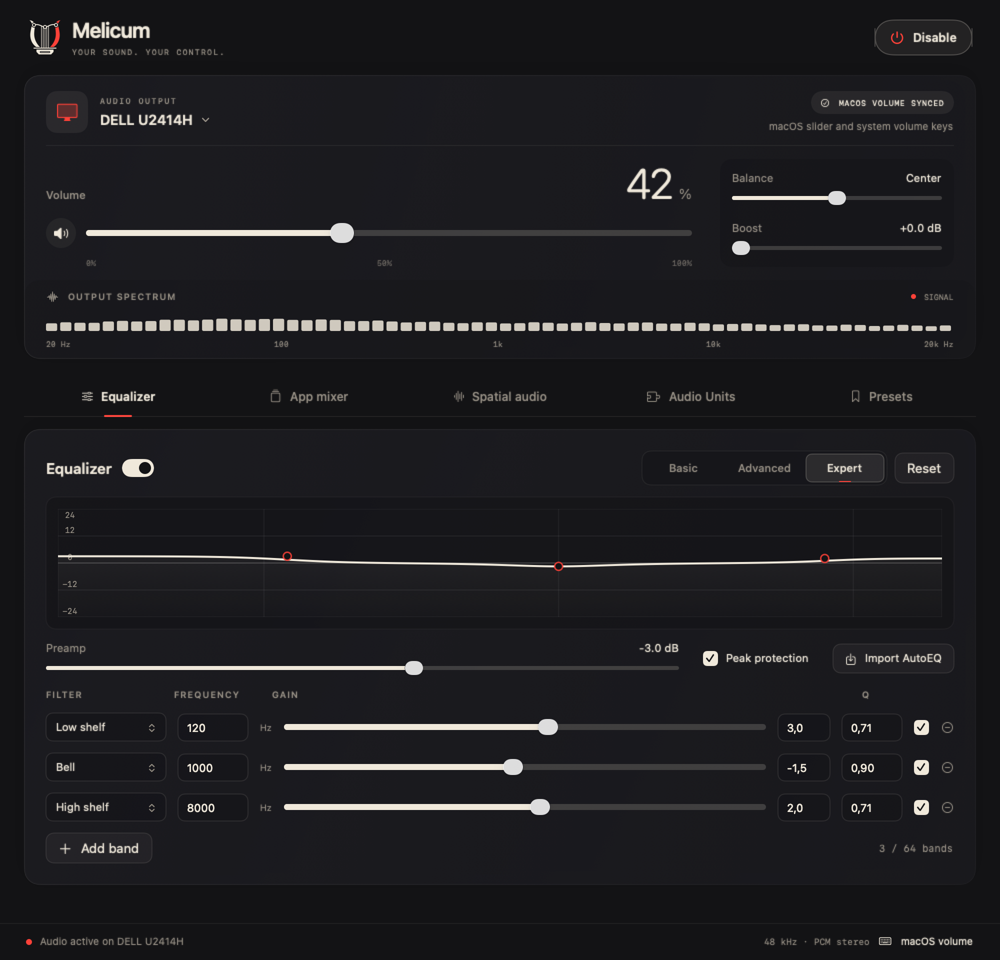
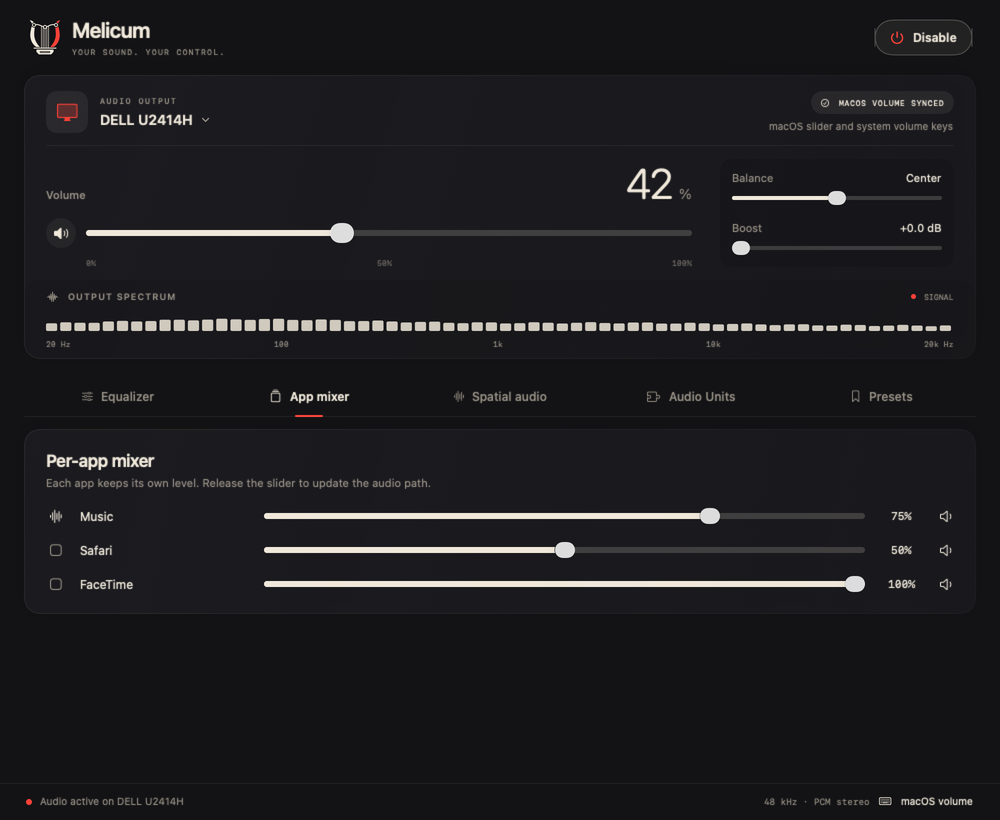
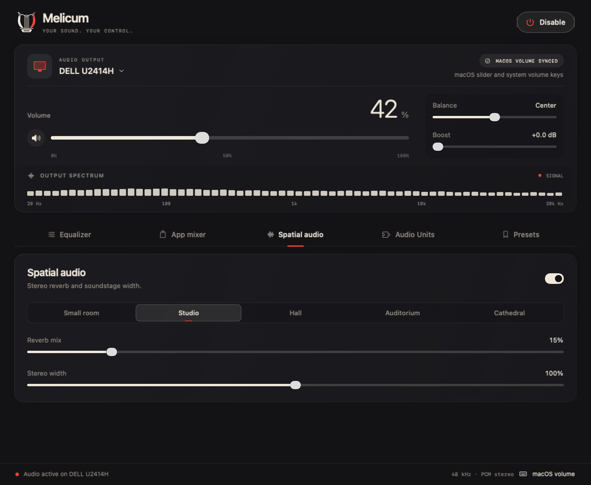
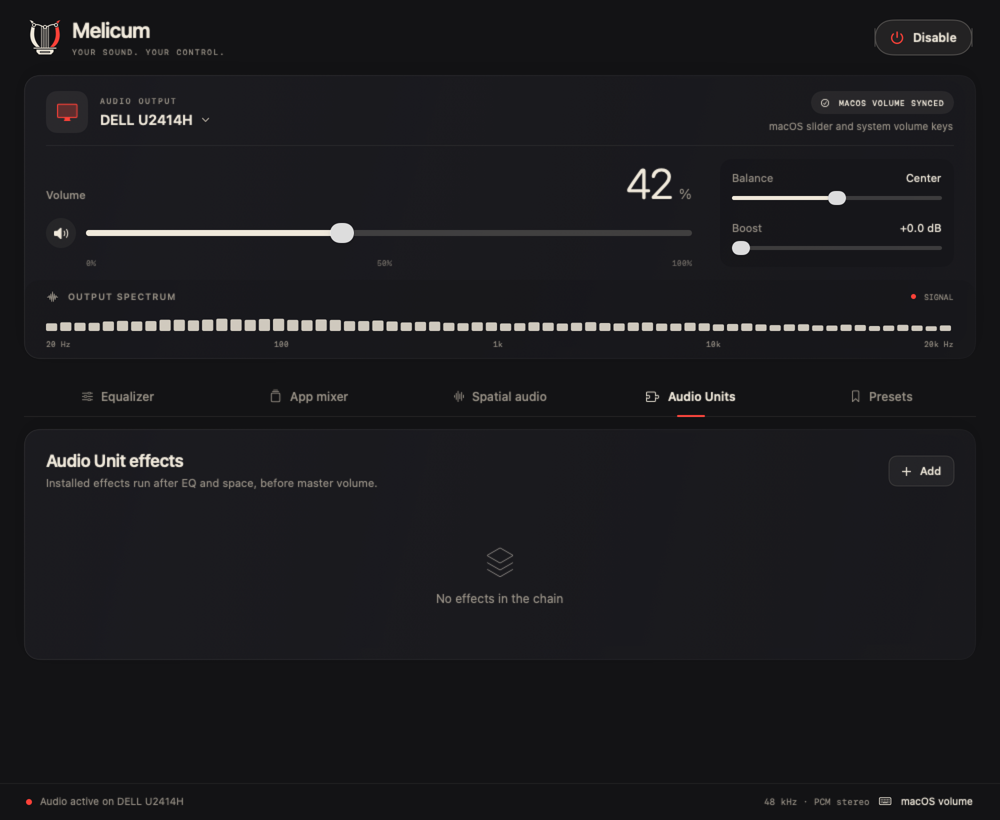
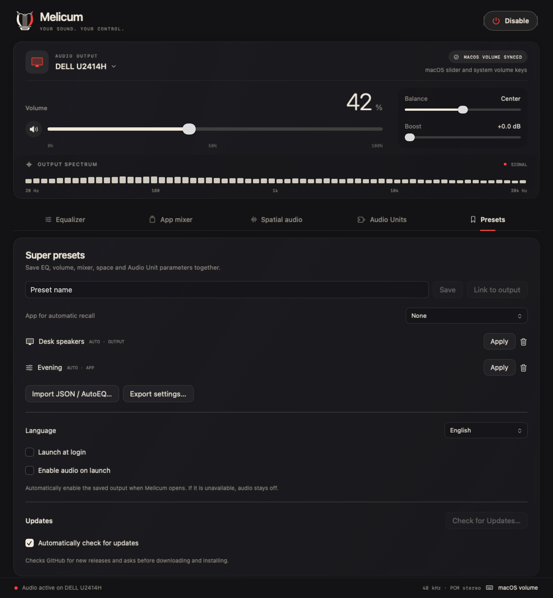
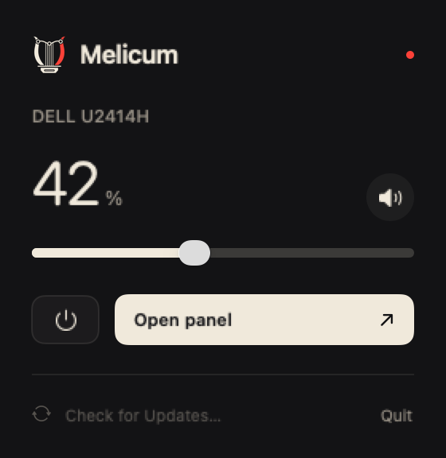

# Melicum user guide

Melicum controls HDMI and DisplayPort audio on macOS 14.2 or later. The main console keeps the output, master controls and live spectrum visible while you edit a settings panel. Its graphite and cream surfaces use small red accents from the original lyre logo.

## Output and master controls

Choose a monitor or device from **Audio output**, then click **Enable audio**. macOS asks for system audio recording permission the first time. Audio is processed in memory on your Mac; Melicum does not record it to a file or send it over the network.

| Control | Behavior |
| --- | --- |
| Audio output | Selects the physical playback device. Identical device names are numbered. Configure multichannel HDMI outputs for stereo in Audio MIDI Setup. |
| Volume | Sets the master output level from 0% to 100%. |
| Mute | Silences the output without losing its saved volume. The main window also supports ⌘M. |
| Balance | Moves the stereo balance left or right. Center keeps both channels balanced. |
| Boost | Adds 0–12 dB of gain. It can raise the level above full scale; use it carefully with EQ and effect gains. |
| Output spectrum | Shows the processed signal across 64 logarithmic frequency bins. It displays OFF, WAITING FOR AUDIO or SIGNAL as appropriate. |
| Disable | Stops processing and restores the previous physical output when it is available. |

The optional system volume component enables the native macOS volume slider and volume keys. Select **Enable system volume…**, authorize its installer, then enable audio again. The virtual output appears as the chosen device followed by **(Melicum)** while processing runs. Volume and mute synchronize in both directions, and gain is applied once in Melicum.

Without that component, **Volume keys** provides a keyboard fallback using Accessibility permission. It does not enable the native HDMI volume slider. The system volume component does not need Accessibility permission.

## Equalizer

Enable or bypass EQ with its switch. The graph shows the combined frequency response; the hollow nodes mark the enabled bands.

| Setting | Behavior |
| --- | --- |
| Basic | Bass, mid and treble controls. |
| Advanced | Ten fixed frequency bands. |
| Expert | Up to 64 filters with frequency, gain, Q and individual bypass. Filter types include bell, low/high shelf, low/high pass, notch and band pass. |
| Preamp | Applies −24 to +12 dB before the master output. Lower it when boosting multiple bands. |
| Peak protection | Clamps individual stream samples to ±0.98. This is not a true-peak limiter, and summed mixer streams can still exceed full scale. |
| Reset | Returns band gains and preamp to zero. |
| Import AutoEQ | Imports a local ParametricEQ `.txt` file in Equalizer APO or REW format. |

Switching to Basic or Advanced initializes that mode's bands. Save an Expert configuration as a preset before switching modes if you want to keep it.

## App mixer

Each application keeps its own level. Drag its slider or use the speaker button to mute it or return it to 100%. A custom level uses a separate process tap for that application. Releasing a slider rebuilds the audio path and can briefly interrupt playback.

## Spatial audio

This panel provides stereo reverb and width control; it does not provide head tracking or multichannel surround output.

- **Spatial audio switch:** enables or bypasses this processing.
- **Space:** selects Small room, Studio, Hall, Auditorium or Cathedral.
- **Reverb mix:** blends the dry signal with reverb, from 0% to 100%.
- **Stereo width:** ranges from 0% to 200%; 100% is the normal stereo width.

## Audio Units

Select **Add** to add an installed compatible Audio Unit. Melicum supports chains of up to 12 effects using stereo float PCM. Effects run after EQ and spatial processing, before master volume. Enable audio to load an effect and show its generic parameter controls. Use its checkbox to bypass it or the trash button to remove it.

Changing the effect chain rebuilds the audio path and may briefly interrupt playback. An incompatible effect can prevent startup; an effect that fails during rendering is bypassed and reported in the panel.

## Presets and preferences

A super preset saves volume, EQ, mixer, spatial settings and Audio Unit parameters together.

| Action or preference | Behavior |
| --- | --- |
| Save | Saves the current audio setup under the entered name. |
| Link to output | Saves a preset associated with the selected physical output. Selecting that output in Melicum recalls it. |
| App for automatic recall | Associates a saved preset with an application. Recall follows the active playback application, preferring the foreground app; otherwise it uses the first active app alphabetically. |
| Apply | Recalls a saved preset. |
| Import JSON / AutoEQ… | Imports a Melicum settings file or a supported ParametricEQ text file. |
| Export settings… | Exports the audio setup to a JSON file you choose. |
| Language | Changes the interface immediately: English, Italian, French, German or Spanish. |
| Launch at login | Opens Melicum when you sign in to macOS. macOS may ask you to confirm the login item. |
| Enable audio on launch | Separately enables the saved output at launch. Off by default. If that output is unavailable, audio stays off. |

Language, startup and updater preferences are separate from audio presets. Audio settings and presets live in `~/Library/Application Support/Melicum/settings.json`.

## Updates

**Automatically check for updates** is enabled by default. Melicum checks the stable GitHub release feed approximately once a day. Turn this preference off to use manual checks only. **Check for Updates…** is available under Presets → Updates, in the Melicum application menu and in its menu bar panel.

When an update is available, Melicum asks before downloading and installing it. It does not install silently. The signed Sparkle feed and archive signature, together with Apple code signing, verify the update. Draft releases and prereleases are not offered by the stable feed.

Updating the app retains audio settings and presets. Before quitting for installation, Melicum closes its audio path and restores the physical output. After relaunch, the **Enable audio on launch** preference determines whether processing starts again.

App updates do not automatically replace the optional audio component. If a release includes a component update, run **Enable system volume…** from that version and complete its administrator installer.

## Quick menu

The lyre icon in the macOS menu bar opens a compact panel with the current output, volume, mute, power control, **Open panel**, **Check for Updates…** and **Quit**.

## Disconnects and quitting

A disconnected device, changed sample rate or a different macOS output can stop processing. Select the desired output and enable audio again. **Disable**, **Quit** and an update shutdown restore the previous physical output before releasing the virtual output. If the app exits unexpectedly, the optional component hides and disables its output after its heartbeat expires.

## Uninstalling

1. Export any presets you want to keep using **Export settings…**.
2. Turn off **Launch at login**, disable audio and quit Melicum.
3. Remove `Melicum.app` from Applications.
4. To remove the optional component, remove `/Library/Audio/Plug-Ins/HAL/MelicumSystemVolume.driver` using an administrator account, then restart the Mac or its audio service. Restarting the audio service briefly interrupts audio from all apps.
5. To reset personal settings as well, remove `~/Library/Application Support/Melicum`, its `local.hdmiaudio.app` preferences and caches, and its saved application state. The older `HDMI Audio` settings folder may also exist after an upgrade.

From a source checkout, `./scripts/uninstall.sh --dry-run` previews the removal. Running `./scripts/uninstall.sh` removes the app and optional component while retaining personal settings. Add `--purge` to remove settings, caches and app permission records; add `--clean-build` to remove this checkout's build artifacts. The script requires the app to be closed and asks for administrator authentication before removing the HAL component. Repository sources and documentation are retained.

## Screenshot maintenance

The screenshots render the actual native SwiftUI views with example device, meter and preset data. They do not start an audio session or modify personal audio settings. From the repository root, run `./scripts/make-screenshots.sh` to regenerate them. The script removes its temporary test harness when it finishes.
